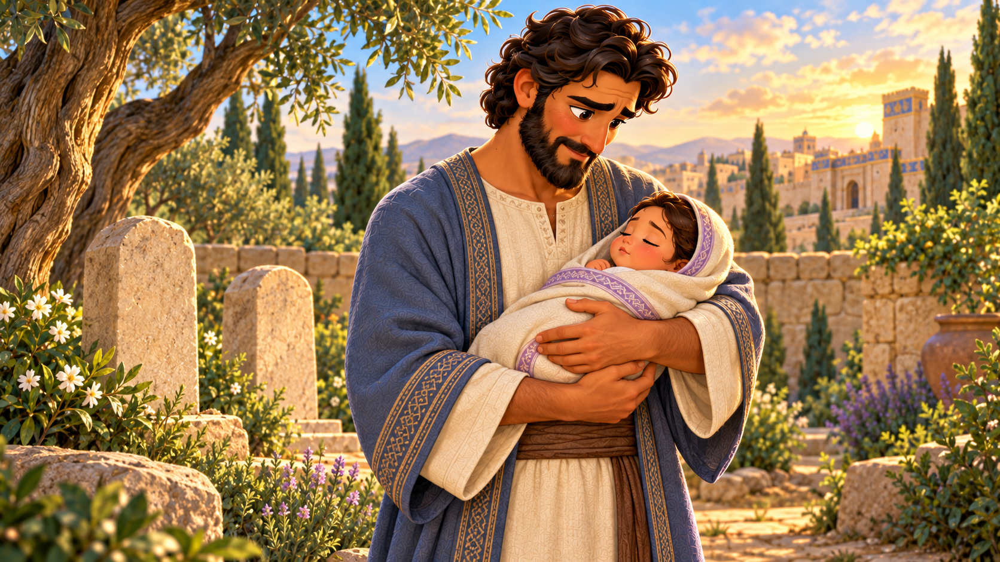
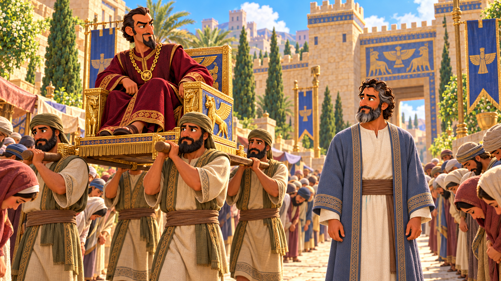
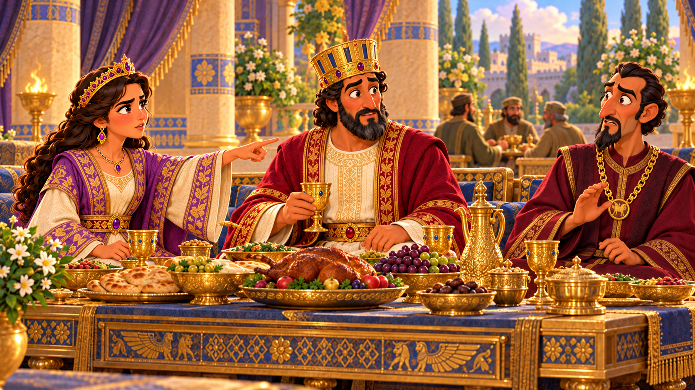
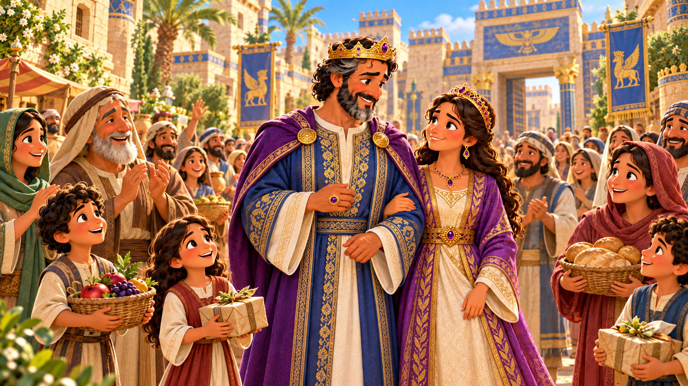

# Helping Each Other Be Brave

## Lesson Brief

- **Series:** Families in the Bible
- **Subject/Theme:** Courage to do right and the good influence of family and friends.
- **Bible Focus:** Mordecai raises Esther, urges her to speak for her people, and supports her as she faces Haman's threat.
- **Main Passage:** Esther 2:5-7, 11, 17, 20-23; 3:1-15; 4-7. Closing resolution: Esther 8:3-17; 9:20-22.
- **Main Point:** Trust God when doing right is hard, and help someone else take a brave step too.
- **Family Connection:** Mordecai was Esther's cousin. When her parents died, he took her as his own daughter and raised her (Esther 2:7).
- **Teaching Pace:** Keep Esther's arrival at the palace brief. Spend most of the lesson on Mordecai's message, Esther's decision, and her courage in speaking to the king.
- **Key Term:** Explain “positive peer pressure” as good influence from others that helps us do right. Mordecai was Esther's older family member and caregiver. Apply his good influence to friendships as well as families.

## Memory Verse

> **Proverbs 27:17**
>
> Iron sharpeneth iron; so a man sharpeneth the countenance of his friend.

## Lesson Outline

Who helps you when you have a hard decision to make? Do you make it all by yourself or do you ask someone for help? I ask a lot of people for help whenever I have a hard decision to make. Sometimes I ask miss Mandy. Sometimes I ask pastor. Sometimes I ask my parents. Do you have anyone like that?

Today we will learn about a young lady who lost her parents and went to live with her older cousin. She had to make some very hard decisions but she had someone she trusted to help her through the hard decisions.

How many of you have friends? Hopefully all of you. Sometimes your friends might lead you to make good decisions. Sometimes you might have friends that lead you to make bad decisions. This is why it's so important to surround yourself with good, godly friends. When you have friends that are always getting in trouble, they will convince you to be naughty too. Here we will get to see Esther get good advice from someone who loved God.

### 1. Mordecai Gives Esther a Home

> **Esther 2:5-7**
> Now in Shushan the palace there was a certain Jew, whose name was Mordecai, the son of Jair, the son of Shimei, the son of Kish, a Benjamite; Who had been carried away from Jerusalem with the captivity which had been carried away with Jeconiah king of Judah, whom Nebuchadnezzar the king of Babylon had carried away. And he brought up Hadassah, that is, Esther, his uncle’s daughter: for she had neither father nor mother, and the maid was fair and beautiful; whom Mordecai, when her father and mother were dead, took for his own daughter.

Esther lost her parents when she was young. Her older cousin, Mordecai, took her in and raised her as his daughter. He worked in the palace. He wasn't a prince or a guard or anything like that, but he had a very respectable job. He helped her a lot with her decisions. He would advise her and give her wisdom.

We won't go into all the details, but when Esther was older, the king of Babylon, Ahasuerus, threw a beauty contest to pick a new queen and Esther ended up winning:

> **Esther 2:17**
> And the king loved Esther above all the women, and she obtained grace and favour in his sight more than all the virgins; so that he set the royal crown upon her head, and made her queen instead of Vashti.

Even as queen, Esther would need a lot of advice and help and prayer from Mordecai. She went to him often when she was scared or had a hard decision.

> **1 Thessalonians 5:11**
> Wherefore comfort yourselves together, and edify one another, even as also ye do.

### 2. An Enemy Threatens Their People

There was an evil a prideful man that because the King's right-hand advisor. His name was Haman. Haman wanted to be like the king. So much so that he wanted people to bow down to him whenever he came by.

> **Esther 3:1-2**
> After these things did king Ahasuerus promote Haman the son of Hammedatha the Agagite, and advanced him, and set his seat above all the princes that were with him. And all the king’s servants, that were in the king’s gate, bowed, and reverenced Haman: for the king had so commanded concerning him. But Mordecai bowed not, nor did him reverence.

Haman got super mad when he found out that Mordecai would not bow to Haman. Do you know why Mordecai didn't bow to Haman? Because we only worship God. Haman wanted to be worshipped. Mordecai would not make Haman to be equal with God.

But this made Haman so upset, that he decided to kill all the Jews, not just Mordecai.

> **Esther 3:5-6**
> And when Haman saw that Mordecai bowed not, nor did him reverence, then was Haman full of wrath. And he thought scorn to lay hands on Mordecai alone; for they had shewed him the people of Mordecai: wherefore Haman sought to destroy all the Jews that were throughout the whole kingdom of Ahasuerus, even the people of Mordecai.

Haman tricked the king to get approval to kill all the Jews on a set day..

> **Esther 3:13**
> And the letters were sent by posts into all the king’s provinces, to destroy, to kill, and to cause to perish, all Jews, both young and old, little children and women, in one day, even upon the thirteenth day of the twelfth month, which is the month Adar, and to take the spoil of them for a prey.

This put whole lot of people and families in danger, including Mordecai and Esther's people. Mordecai saw the announcement and trembled in fear because he knew this was an execution date for everyone of his people.

> **Esther 4:1**
> When Mordecai perceived all that was done, Mordecai rent his clothes, and put on sackcloth with ashes, and went out into the midst of the city, and cried with a loud and a bitter cry;

Esther sent a messenger to find out why he was so troubled. Mordecai gave the messenger a copy of the order and told him to ask Esther to speak to the king for her people.

Remember how I mentioned earlier that your friends will either encourage to do right or encourage you to do wrong? We call that peer pressure. They might root you on to do something, or make fun of you for not doing something, or tell you how they will only be your friend if you act a certain way. Those are all forms of peer pressure. Here we see Mordecai encouraging Esther to stand up for her people. She was queen after all. If anyone could talk to the King, it would be her.

But she was scared. She was just a humble Jewish girl. Sure she was queen, but she had been forced to be queen. She didn't grow up in the palace or around royalty or know how to act around rich and powerful people. She also knew that if someone approached the king without an appointment, they could be killed on the spot.

### 3. Mordecai Helps Esther Face a Hard Choice

**Summary/Lesson:** Esther sent back an answer explaining the danger. Anyone who entered the king's inner court without being called could be put to death. The king could allow the person to live by holding out his golden sceptre, a royal staff. Esther had not been called to see him for thirty days. Speaking to the king carried a real risk, even for the queen.

Mordecai answered firmly. He warned that the palace would not keep her safe from the threat against her people. He also asked whether her place as queen might be an opportunity to help at this very time. 

> **Esther 4:14**
> For if thou altogether holdest thy peace at this time, then shall there enlargement and deliverance arise to the Jews from another place; but thou and thy father’s house shall be destroyed: and who knoweth whether thou art come to the kingdom for such a time as this?

Mordecai's message helped Esther consider the people who needed her help. He was lovingly, but firmly, explaining to her the seriousness of the issue. He was explaining to her to trust in God and do her part.

Good godly friend will push you to do right, even if it hurts to hear, or if they have to get a little bit harsh to help you see the importance. But that is someone how loves you and wants to see you please God.

> **Hebrews 10:24**
> And let us consider one another to provoke unto love and to good works:

### 4. Esther Asks Others to Stand with Her

**Main Passage:** Esther 4:15-17.

**Summary/Lesson:** Esther accepted the challenge and sent Mordecai a request of her own. She asked him to gather the Jews in Shushan to fast for her for three days. She and her maidens would fast too. Explain fasting simply as going without food; in this passage they also went without drink. Esther then said she would go to the king, although it was against the law to enter without being called. Her words, “and if I perish, I perish,” show that she understood the danger and had decided to act.

Mordecai did what Esther asked. Notice how the help went both ways. He had urged her to speak, and she asked him to gather support. Esther's courage was part of a shared effort. She had a part at the palace, and Mordecai had a part among the people outside it.

**Supporting Scriptures:** First Thessalonians 5:11 teaches believers to strengthen one another. Psalm 56:3 gives us words of trust when we are afraid.

**Practical Application for Children:** When you need courage, ask a parent or teacher to pray with you. Tell them what makes the right choice hard. When someone else needs help, listen and offer support. You might say, “I will pray for you,” and then follow through.

**Illustration:** Have a volunteer carry a light box containing several classroom items. Give another volunteer a helpful part, such as opening the door or clearing the path. Explain that each person can help while doing a different task. Connect this with Esther and Mordecai's different roles.

### 5. Esther Takes the Brave Step

Esther finally mustered up the courage she needed. She was going to do it, but she needed God to help her. So she asked all the Jews in Shushan and her servants to fast and pray for 3 days and then she would go before the king:

> **Esther 4:15-17**
> Then Esther bade them return Mordecai this answer, Go, gather together all the Jews that are present in Shushan, and fast ye for me, and neither eat nor drink three days, night or day: I also and my maidens will fast likewise; and so will I go in unto the king, which is not according to the law: and if I perish, I perish. So Mordecai went his way, and did according to all that Esther had commanded him.

On the third day, Esther put on her royal clothing and stood in the inner court where the king could see her. There she was, standing before the king; would he kill her, or would he accept her? The king saw her and held out the golden sceptre. She had been received! God had heard the prayers of His people!

The king asked what she wanted. Esther invited him and Haman to a banquet she had prepared. At that meal, she asked them to return for another banquet the next day. She was still scared to confront the king about the evils of Haman and in front of Haman. She knew she had to do it.

> **Psalms 56:3**
> What time I am afraid, I will trust in thee.

### 6. Esther Speaks for Her People

At the second banquet, the king asked her what she wanted. Esther asked the king to spare her life and the lives of her people. 

> **Esther 7:4-6**
> For we are sold, I and my people, to be destroyed, to be slain, and to perish. But if we had been sold for bondmen and bondwomen, I had held my tongue, although the enemy could not countervail the king’s damage. Then the king Ahasuerus answered and said unto Esther the queen, Who is he, and where is he, that durst presume in his heart to do so? And Esther said, The adversary and enemy is this wicked Haman. Then Haman was afraid before the king and the queen.

Esther spoke about the danger even in the presence of the enemy. Mordecai's encouragement had led to Her making a good and brave decision, and Esther followed through by speaking for people who needed help.

### 7. Their Courage Helps Bring Rescue

Haman was punished for his evil plan. The king had him killed the very way Haman was planning on killing Mordecia. Esther's people, the Jews, were all saved. Not only that, but all of Haman's belongings were given to Esther, Mordecai was greatly honored and given the king's ring, royal apparel, and a crown. Many people got saved. And they even created a new holiday that is celebrated by the Jews to this day: Purim.

Remember that it was the loving encouragement from Mordecai that pushed Esther to make good, brave decisions. Mordecai cared for Esther and urged her to help. She accepted his challenge, asked for support, and acted with courage. We need to receive good advice as well. And we need to encourage others to do right too. It is so important that we encourage our friends to do right. Never push them to make bad or wrong decisions.

## Segue Into The Plan Of Salvation

The Jews needed rescue from Haman's plan. Each of us also needs rescue from sin. Sin is disobeying God in our thoughts, words, or actions. Romans 3:23 teaches that all have sinned. That includes people who do brave and kind things.

We cannot remove our sin by helping others or doing enough good works. Ephesians 2:8-9 teaches that salvation is God's gift, received through faith. God sent His Son, Jesus Christ, to save us. Jesus died for our sins, was buried, and rose again the third day, as First Corinthians 15:3-4 tells us.

Trust Jesus to save you. Romans 10:13 says, “For whosoever shall call upon the name of the Lord shall be saved.” If you want to understand this, speak with a teacher after the lesson. A Christian can help a friend understand the good news of Jesus. Each person must personally trust Him.

## Review Questions and Answers

1. **How was Mordecai related to Esther?**  
   **Answer:** He was her older cousin, and he raised her as his own daughter.
2. **Why did Esther need Mordecai to give her a home?**  
   **Answer:** Her father and mother had died.
3. **What did King Ahasuerus make Esther?**  
   **Answer:** He made her queen.
4. **What was the name of the proud man who became an important advisor to the king?**  
   **Answer:** Haman.
5. **Why did Haman become angry with Mordecai?**  
   **Answer:** Mordecai would not bow down to him.
6. **What did Haman plan to do to the Jews?**  
   **Answer:** He planned to have all the Jews in the kingdom killed on a set day.
7. **How did Esther find out why Mordecai was so troubled?**  
   **Answer:** She sent a messenger to ask him.
8. **What did Mordecai ask Esther to do for her people?**  
   **Answer:** Speak to the king and ask for help.
9. **Why was Esther afraid to approach the king?**  
   **Answer:** Someone who entered his inner court without being called could be put to death.
10. **What could the king hold out to show that a person could approach him safely?**  
    **Answer:** His golden sceptre, a royal staff.
11. **What did Mordecai mean when he asked whether Esther had become queen “for such a time as this”?**  
    **Answer:** Her position as queen might give her an opportunity to help her people at that very time.
12. **What did Esther ask the Jews in Shushan to do before she went to the king?**  
    **Answer:** Fast for her for three days, without eating or drinking. She and her maidens would fast too.
13. **What did Mordecai do when Esther asked him to gather the Jews to fast?**  
    **Answer:** He did what she asked.
14. **According to Psalm 56:3, what should we do when we are afraid?**  
    **Answer:** Trust in God.
15. **Whom did Esther invite to her banquets?**  
    **Answer:** The king and Haman.
16. **What did Esther ask the king to spare at the second banquet?**  
    **Answer:** Her life and the lives of her people.
17. **What happened to Haman after Esther identified him as the enemy?**  
    **Answer:** The king had him put to death in the way Haman had planned to kill Mordecai.
18. **What holiday did the Jews establish to remember their rescue?**  
    **Answer:** Purim.
19. **What kind of decisions should a good, godly friend encourage us to make?**  
    **Answer:** Right decisions that please God, even when they are hard or take courage.
20. **Can doing brave or kind things save us from sin? Who can save us?**  
    **Answer:** Our good works cannot save us. We must trust Jesus, who died for our sins and rose again.
