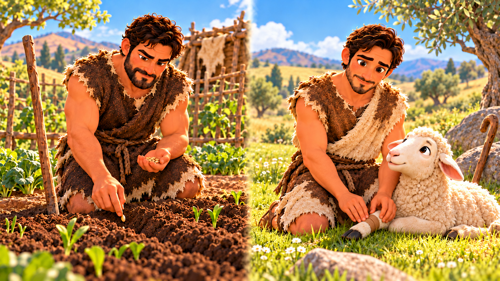
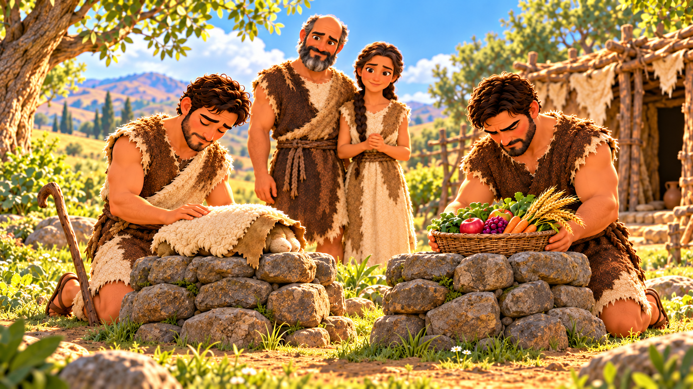
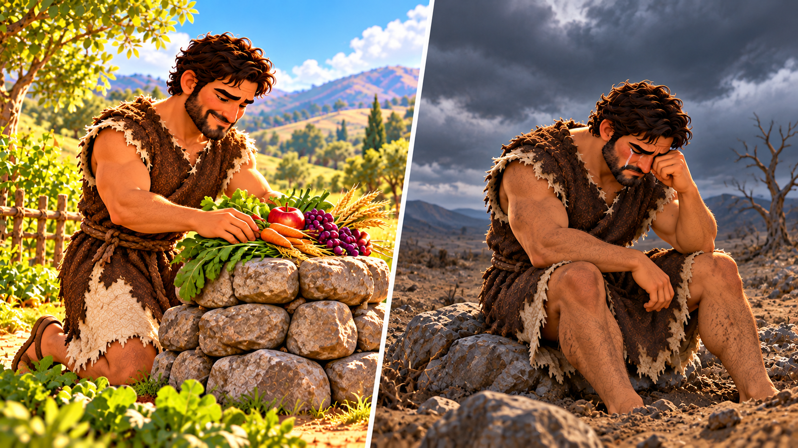
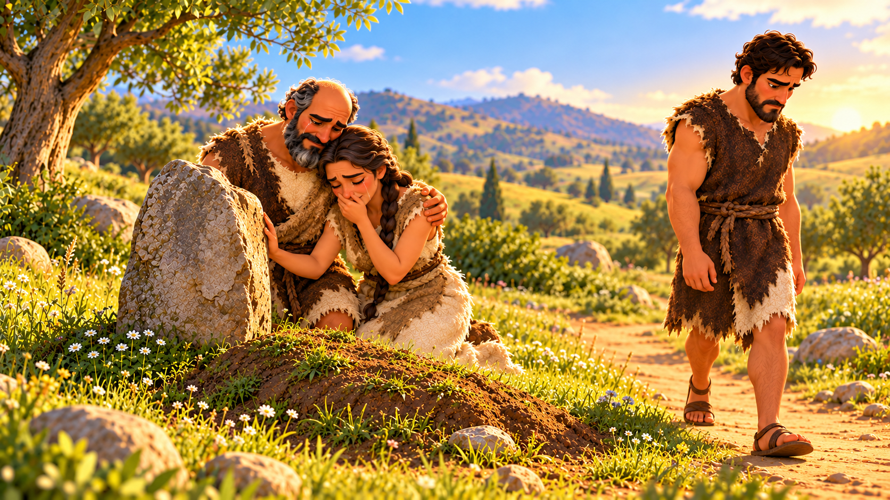

# When Jealousy Grows

## Lesson Brief

- **Series:** Families in the Bible
- **Subject/Theme:** Cain and Abel, jealousy, and the harm jealousy can bring to a family.
- **Bible Focus:** The brothers' family and work, their offerings to God, Cain's anger, God's warning, and Cain's choice to kill Abel.
- **Main Passage:** [Genesis 4:1-16](https://www.kingjamesbibleonline.org/Genesis-Chapter-4/). Family background: Genesis 3:17-24. Later family reference: Genesis 4:25. Read Hebrews 11:4 and 1 John 3:11-18 alongside the story.
- **Main Point:** Bring jealousy to God and obey His Word before it grows into choices that hurt others.
- **Key Term:** In this lesson, jealousy means resenting someone because they have something we want or receive praise we want. The supporting verses often call this envy. Explain resentment as holding on to anger against someone.

## Memory Verse

> **James 3:16**
> For where envying and strife is, there is confusion and every evil work.

## Lesson Outline

**Opening illustration:** Ask children to imagine that a teacher gave them an assignment. They worked very hard on that assignment and were very proud of the work they did. Then they submitted the work to the teacher. The next day, they got a failing grade, but their friend got a 100%. Ask, “What might you feel? What could you choose to do?” Take a few brief answers.

Explain that wanting to do well is good. But jealousy or envy begins when someone else's good becomes a reason to resent them. Today we will see what happened when Cain held on to that resentment.

### 1. Two Brothers in Adam and Eve's Family

> **Genesis 4:1-2**
> And Adam knew Eve his wife; and she conceived, and bare Cain, and said, I have gotten a man from the LORD. And she again bare his brother Abel. And Abel was a keeper of sheep, but Cain was a tiller of the ground.

**Summary/Lesson:** Adam and Eve had disobeyed God and had been sent out of the garden of Eden. Working became hard and less pleasant than it had been in the garden. After leaving the garden Adam and Eve had two sons: Cain and Abel.

Cain became a farmer who worked the ground. He enjoyed gardening. He like experimenting with growing plants. What made them grow better? He probably experimented with different soil types, how much sun the plants got, and which plants to grow close to other plants. That's what he enjoyed doing and that's how he helped his family.

Abel, on the other hand, loved tending to sheep. He fed them, cared for them, protected and loved them. He learned what food they liked, the best places to bring them to drink and sleep, and the best way to trim their wool.

These were their jobs, these were the things they enjoyed doing and how they contributed to taking care of the family and the world they lived in. They were brothers, but they were different people who like different things and had different skills. Just like you and your siblings, you will like and be good at different things. That doesn't make one of you better than the other, it just makes you different.

### 2. The Brothers Bring Their Offerings to God

> **Genesis 4:3-5**
> And in process of time it came to pass, that Cain brought of the fruit of the ground an offering unto the LORD. And Abel, he also brought of the firstlings of his flock and of the fat thereof. And the LORD had respect unto Abel and to his offering: But unto Cain and to his offering he had not respect. And Cain was very wroth, and his countenance fell.

**Summary/Lesson:** The Bible doesn't explain why they did, but the time came where Cain and Abel brought an offering to the Lord. Cain brought an offering from the fruit of the ground. Abel brought the firstlings of his flock and their fat.

🗣️ **Firstlings** -  The first born animals

Both brothers brought something to the Lord. But God did not accept both of their offerings. 

Just like the teacher we talked about at the beginning of the lesson who had requirements for the project, God has requirements when we come to Him. We cannot just bring whatever we want and expect God to be happy.

God had respect unto Abel and his offering, which means He accepted them. Cain and his offering were rejected. Cain became very angry about it. You might ask "why did God accept Abel's offering but not Cain's?" and that would be a very good question. The Bible doesn't tell us much, but later it gives us a little hint:

> **1 John 3:12**
> Not as Cain, who was of that wicked one, and slew his brother. And wherefore slew he him? Because his own works were evil, and his brother’s righteous.

Whatever it was, the Bible calls Cain's works evil. No matter how sincere you are, if you bring an evil offering to God, it will be rejected. Even if you don't know if it is evil. God cannot accept evil works. We must be careful to live righteously for God.

There are a lot of people out there who are sincerely trying to serve God, but their acts don't follow the requirements God put in the Bible. God cannot accept those works. That is why it is important to read the Bible and go to a good church and listen, so that you will understand what is good and righteous and acceptable unto God.

**Practical Application for Children:** When you sing, pray, or give at church, think about the God you are worshipping. Ask Him to help you trust Him and obey His Word. If you receive correction, listen so you can learn what needs to change.

### 3. Cain Resents a Brother Who Has Done Right

> **Genesis 4:6-7**
> And the LORD said unto Cain, Why art thou wroth? and why is thy countenance fallen? If thou doest well, shalt thou not be accepted? and if thou doest not well, sin lieth at the door. And unto thee shall be his desire, and thou shalt rule over him.

**Summary/Lesson:** Abel had done right before God. Cain's own works were evil. Abel's acceptance gave Cain no reason to hate him though. God even asked Cain why he was so mad. He told Cain if he changed his actions then his offering would be accepted too. It wasn't because God didn't like Cain. It was simply because what Cain brought was wrong. He just had to change something.

Just like the teacher and the homework project, It's not because the teacher hated the student, it was because their was something wrong with the project. Fix the thing that is wrong and it will be accepted.

Cain needed to receive God's correction. He needed to listen to God and simply change what he did. His brother's right conduct could have been an example for him to follow. He could have learned from Abel's offering.

God said, “If thou doest well, shalt thou not be accepted?” Cain could have simply tried again. When someone else does better than us, that is a way for us to learn, to grow, to do better. Don't get jealous when someone else does better. Instead, be happy for them and try to learn from them. 

**Practical Application for Children:** Imagine your sister receives praise for cleaning her room while you are reminded to clean yours. Her obedience is good. Accept the reminder and begin your own task. Instead of getting mad at her, tell her she did a good job, and then do a better job yourself.

### 4. God Warns Cain Before He Hurts Abel

**Summary/Lesson:** When God spoke to Cain, he said “sin lieth at the door.” God was giving Cain a serious warning. He was telling Cain that he was on the verge of doing something very bad. He needed to get right or something very bad would happen.

There are many times in the Bible where God warns people before they do something very bad. Sometimes they head God's warnings, and sometimes they don't.:

- Abigail warning David to not kill Nabal
- God sending Jonah to warn the Ninevites
- God warning the Israelites against taking from Jericho: Achan
- Pharoah and the 10 plagues

**Practical Application for Children:** Notice when you keep thinking, “I wish they would lose,” or when you want to say something cruel. Pause before you make the wrong choice and ask God to help you do right. It can be very hard, because our pride wants us to be right or best or to not look weaker than another person.

### 5. Jealousy Leads Cain to Destroy His Brother's Life

> **Genesis 4:8-10**
> And Cain talked with Abel his brother: and it came to pass, when they were in the field, that Cain rose up against Abel his brother, and slew him. And the LORD said unto Cain, Where is Abel thy brother? And he said, I know not: Am I my brother’s keeper? And he said, What hast thou done? the voice of thy brother’s blood crieth unto me from the ground.

**Summary/Lesson:** Cain was warned by God and given the opportunity to make things right. He could have prepared another offering and had it accepted by God. He could have had a good relationship with his brother, his life could have gone in a good direction, but he chose to let his jealousy and pride rule.

When Cain was out in the field talking with Able, he allowed his anger, his jealousy, and his pride to take over his actions. He did not follow God's wisdom or warnings. And there in the field, he killed his own brother, simply because he didn't do right. Abel did nothing wrong, Cain was the only person responsible for God not accepting his offering. But instead of taking responsibility and changing his actions, he killed his own brother!

God then asked where Abel was. Cain answered, “I know not: Am I my brother's keeper?” Cain lied to God. His jealousy and pride continued to lead to more and more sin. God knew what had happened. Cain's violence mattered to God. His attempt to hide it added another sin. 

**Practical Application for Children:** Jealousy can lead a child to mock a sibling, spread a lie, leave someone out, damage their work, or hit them. Each choice hurts a person. And it might make you feel good, but everyone else sees you as a fool. Every jealous feeling does not end in murder, but Cain's story shows how serious the danger can become.

**Illustration:** Describe a child whose brother wins a drawing contest. The child tears the winning picture out of jealousy. Ask what has been hurt besides the paper: the brother's feelings and the trust between them. Make clear that Abel's death was much more serious and permanent. Keep the illustration brief so Abel's loss remains central.

### 6. The Destruction Reaches Cain and His Family

**Summary/Lesson:** God punished Cain. His judgment changed Cain's life:

- He would lose his ability to grow things - This was where Cain got his fulfillment from. This was his livelihood, his job, his thing! He completely lost it now. He would never be able to grow anything again.
  👉 Explain how this would be like them never being able to play with their favorite toy or going to their favorite place again
- He would always be on the run - Others would want to kill him or be scared of him. He would not be able to keep friends or stay in one place for very long. He would constantly be moving. He would wander for the rest of his life, never having a place to just call home.
  👉 Explain how this would be like them never being able to have a friend
- God would no longer be with him - No longer would God talk to him. There was no hope of God ever accepting his offering again. He lost the greatest friend he could ever have. He was truly alone.
  👉 Explain how this would be like them never having anyone to go to for help or comfort or being able to pray or go to church

Cain was devistated. He lost pretty much everything! His family, his God, his joy, any hope of having friends or fulfillment in life. All gone in one instance of anger and uncrolled jealousy.

Cain wasn't the only person that suffered. Adam and Even lost Abel. Their son was gone. They would suffer tremendous grief. Cain's sin brought pain and suffering to others as well.

This is the cost of sin boys and girls. This is what happens when you don't listen to God's warnings and when you don't obey His Word.

### 7. Ask God for Help and Practice Love

**Summary/Lesson:** Cain's story shows why we need to deal with our jealousy and pride as soon as we notice it. God calls us to walk in the Spirit, which means to live the way God would want us to. Galatians 5:22-23 describes that:

> **Galatians 5:16**
> This I say then, Walk in the Spirit, and ye shall not fulfil the lust of the flesh.
>
> **Galatians 5:22-23**
> But the fruit of the Spirit is love, joy, peace, longsuffering, gentleness, goodness, faith, Meekness, temperance: against such there is no law.

Children who belong to Jesus, who pray, read the Bible, go to church and listen with a good spirit and open heart will live the way God wants us to automatically. That is why it is so important for us to listen to our parents, to the Bible, to the preaching, and to read God's Word

**Practical Application for Children:** Teach these steps as ways to act on God's Word:

1. **Notice the jealousy.** Why are you mad at someone? What about them do you want?
2. **Tell God the truth.** Confess any sinful thought or action. Ask Him to help you obey. Ask Him to show you what to do to be better.
3. **Look at what you need to change.** Maybe you just need to be happy for someone else. Maybe you need to work harder on something. Maybe there is a sin you need to stop.
4. **Make the change.** It's not enough to see what you need to change, you have to make the change. This can be the hardest part. But once you do it, you will feel better and God will start blessing your effort.

For an imagined example, your friend is chosen to help the teacher. You wanted that turn. Admit to God you wanted to go first but that is wrong. Cheer for your friend, and let them enjoy their turn. Then you can practice letting others go before you on your own.

## Segue Into The Plan Of Salvation

Cain paid dearly for his sins. The Bible explains to us that if we don't accept Jesus payment for our sin, then we will pay dearly for our sin too:

> **Romans 3:23**
> For all have sinned, and come short of the glory of God;

We need Jesus to save us from our sin. Practicing kindness and making better choices cannot take our sin away. Ephesians 2:8-9 teaches that salvation is God's gift, received through faith.

> **Ephesians 2:8-9**
> For by grace are ye saved through faith; and that not of yourselves: it is the gift of God: Not of works, lest any man should boast.

First John 3:16 points us to Jesus' love: 

> **1 John 3:16**
> Hereby perceive we the love of God, because he laid down his life for us: and we ought to lay down our lives for the brethren.

Jesus gave His life for sinners. He died for our sins, was buried, and rose again the third day, as 1 Corinthians 15:3-4 tells us:

> **1 Corinthians 15:3-4**
> For I delivered unto you first of all that which I also received, how that Christ died for our sins according to the scriptures; And that he was buried, and that he rose again the third day according to the scriptures:

Romans 10:9-10 shows us that each person must trust Jesus personally.

> **Romans 10:9-10**
> That if thou shalt confess with thy mouth the Lord Jesus, and shalt believe in thine heart that God hath raised him from the dead, thou shalt be saved. For with the heart man believeth unto righteousness; and with the mouth confession is made unto salvation.

If you have trusted Jesus, bring your jealousy to Him. Confess your sin and seek His help to love the person you resented.

## Review Questions and Answers

1. **Who were Cain and Abel's parents?**  
   **Answer:** Adam and Eve.
2. **What work did Cain do?**  
   **Answer:** He was a farmer who worked the ground.
3. **What work did Abel do?**  
   **Answer:** He cared for sheep.
4. **What did Cain bring as an offering to the Lord?**  
   **Answer:** Fruit of the ground, or things he had grown.
5. **What did Abel bring as an offering to the Lord?**  
   **Answer:** The firstlings of his flock and their fat. Firstlings means the firstborn animals.
6. **Whose offering did God accept?**  
   **Answer:** Abel's offering.
7. **How did Cain react when God rejected his offering?**  
   **Answer:** He became very angry, and his face showed it.
8. **What does jealousy mean in this lesson?**  
   **Answer:** Resenting someone because they have something we want or receive praise we want.
9. **What serious warning did God give Cain about sin?**  
   **Answer:** God told him that “sin lieth at the door.”
10. **What should Cain have done when God corrected him?**  
    **Answer:** Listen to God, turn from his sin, and do what was right.
11. **Who listened when Abigail warned him against killing Nabal and the men of his household?**  
    **Answer:** David.
12. **What did Cain do to Abel when they were in the field?**  
    **Answer:** He killed his brother.
13. **What lie did Cain tell when God asked where Abel was?**  
    **Answer:** He said, “I know not.”
14. **Could Cain hide what he had done from God?**  
    **Answer:** No. God knew what had happened to Abel.
15. **How did Cain's sin hurt Adam and Eve?**  
    **Answer:** They lost their son Abel and suffered grief.
16. **Name one consequence of God's judgment on Cain.**  
    **Answer:** The ground would no longer give him its strength, or he would become a wanderer.
17. **According to James 3:16, what comes where there is envy and strife?**  
    **Answer:** Confusion and every evil work. Envy means jealousy, and strife means fighting.
18. **Your brother or sister receives praise for doing a good job. How can you respond with love?**  
    **Answer:** Answers will vary. Be happy for them, tell them they did well, and give your own work careful effort.
19. **What should you do when you notice jealous thoughts growing?**  
    **Answer:** Tell God the truth and ask for His help. Look at what you need to change, then act on His Word.
20. **Can better choices take away our sin, and who can save us?**  
    **Answer:** Better choices cannot take away our sin. We must trust Jesus, who died for our sins and rose again.
