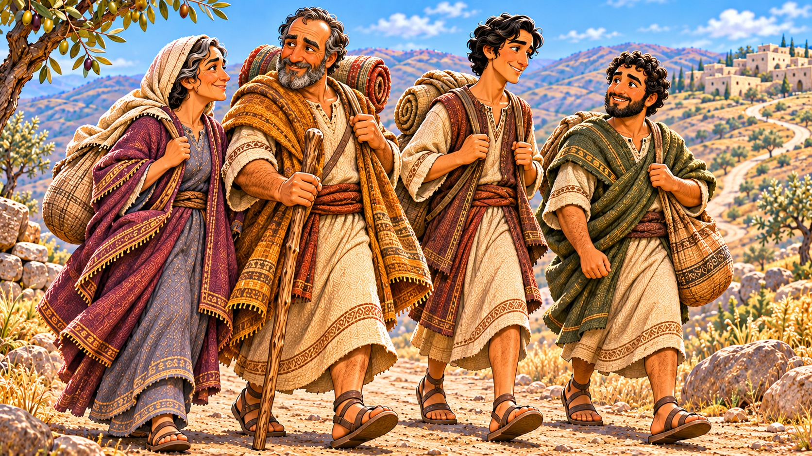
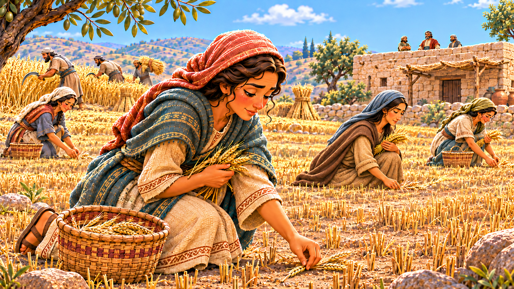

# Love Sticks Together

## Lesson Brief

- **Series:** Families in the Bible
- **Subject/Theme:** Naomi, Orpah, Ruth, and Boaz; faithful love within a family.
- **Bible Focus:** Ruth chooses to stay with Naomi, cares for her, and receives her guidance as God brings help and new joy to their family.
- **Main Passage:** [Ruth 1-4 (KJV)](https://www.biblegateway.com/passage/?search=Ruth+1-4&version=KJV). Family line: [Matthew 1:1-16 (KJV)](https://www.biblegateway.com/passage/?search=Matthew+1%3A1-16&version=KJV).
- **Main Point:** God calls us to love our family by putting others first and staying faithful when life is hard.
- **Teaching Aim:** Each child will choose one way to help a family member this week and receive godly guidance from a trusted adult.

## Memory Verse

> **Philippians 2:4**
> Look not every man on his own things, but every man also on the things of others.

## Lesson Outline

### 1. A Family Leaves Home and Faces Great Loss

> **Ruth 1:1-5**
> Now it came to pass in the days when the judges ruled, that there was a famine in the land. And a certain man of Bethlehemjudah went to sojourn in the country of Moab, he, and his wife, and his two sons. And the name of the man was Elimelech, and the name of his wife Naomi, and the name of his two sons Mahlon and Chilion, Ephrathites of Bethlehemjudah. And they came into the country of Moab, and continued there. And Elimelech Naomi’s husband died; and she was left, and her two sons. And they took them wives of the women of Moab; the name of the one was Orpah, and the name of the other Ruth: and they dwelled there about ten years. And Mahlon and Chilion died also both of them; and the woman was left of her two sons and her husband.

**Summary/Lesson:** A long time ago, before the kings of Israel, during the time of the judges, there was a famine in the land of Israel. A family decided they were going to leave their country and go elsewhere to find food. Elimelech and Naomi left Bethlehem with their sons, Mahlon and Chilion, and went to live in Moab.

After a while, Naomi's husband, Elimelech, died there. The sons married Moabite women named Orpah and Ruth. After about ten years in Moab, both sons had also died. Naomi had lost her husband and both sons. She was heartbroken, and as many people who lose their children and spouse, she lost a lot of her joy and will to live. Her daughter-in-laws, Orpah and Ruth, had each lost their husbands too. Explain *widow* as a woman whose husband has died. All three women were grieving, and they faced an uncertain future.

### 2. Naomi Starts Home, and Orpah Turns Back

> **Ruth 1:6-8**
> Then she arose with her daughters in law, that she might return from the country of Moab: for she had heard in the country of Moab how that the LORD had visited his people in giving them bread. Wherefore she went forth out of the place where she was, and her two daughters in law with her; and they went on the way to return unto the land of Judah. And Naomi said unto her two daughters in law, Go, return each to her mother’s house: the LORD deal kindly with you, as ye have dealt with the dead, and with me.

**Summary/Lesson:** Naomi heard that the famine in Israel ended. She started back toward home with both Orpah and Ruth. On the way, she urged them to return to their own parents. She was going back to a land that was not where Orpah and Ruth were from or familiar with. It would be very different for them. Noami thought it better for them to stay in their own country. She thanked them for the kindness they had shown and prayed that the Lord would give them rest in new homes.

The women wept. At first, both wanted to go with Naomi. After Naomi urged them again, Orpah kissed her goodbye and returned to her people in Moab. But Ruth held on to Naomi. 

What would you do? Would you travel to a foreign land to live? Or would you rather stay here where you can speak the language, you know how to act, you know how the people think and what the laws are.

Naomi was being very thoughtful for Orpah and Ruth. She lost her husband and all her children. Orpah and Ruth were all she had left, and instead of begging them to go with her, she offered to let them stay in the country they were familiar with and loved.

It's important that we are thoughtful of others and put their needs before our own.

### 3. Ruth Chooses Naomi and Naomi's God

> **Ruth 1:16-18**
> And Ruth said, Intreat me not to leave thee, or to return from following after thee: for whither thou goest, I will go; and where thou lodgest, I will lodge: thy people shall be my people, and thy God my God: Where thou diest, will I die, and there will I be buried: the LORD do so to me, and more also, if ought but death part thee and me. When she saw that she was stedfastly minded to go with her, then she left speaking unto her.

**Summary/Lesson:** Ruth committed herself to Naomi for life. She loved Naomi and wouldn't abandon her. She didn't want to see Naomi suffer any more that she already did. So instead of going home she decide to stay with her. It was more than that though, she had to learn and accept everything about her including God. Ruth was from Moab. The moabites didn't believe in the same God we do. She was making a huge change in her life to make sure Naomi would have someone with her.

When they finally got to Bethlehem, it was about the time that harvest season was starting

### 4. Ruth Works to Help Naomi, and Boaz Shows Kindness

> **Ruth 2:1-3**
> And Naomi had a kinsman of her husband’s, a mighty man of wealth, of the family of Elimelech; and his name was Boaz. And Ruth the Moabitess said unto Naomi, Let me now go to the field, and glean ears of corn after him in whose sight I shall find grace. And she said unto her, Go, my daughter. And she went, and came, and gleaned in the field after the reapers: and her hap was to light on a part of the field belonging unto Boaz, who was of the kindred of Elimelech.

**Summary/Lesson:** Ruth asked Naomi if she could go into the fields to glean. She went glean and "just so happened" to work in a field belonging to Boaz, a relative of Naomi's late husband.

> 👉 Glean means to gather up the leftovers after a harvest

Boaz learned who Ruth was, that she was the daughter-in-law of his relative, Elimelech. He learned how she stayed with Naomi and was helping take care of her. He learned that she had learned about and started following God. He began to look out for her and made sure she got extra grain from the harvest. He told her to stay with his women workers, made water available to her, and told the men to leave her safe.  At mealtime, he gave her food. She worked hard to help provide for Naomi and God was blessing her efforts.

### 5. Naomi Guides Ruth and Seeks Her Good

> **Ruth 2:19-23**
> And her mother in law said unto her, Where hast thou gleaned to day? and where wroughtest thou? blessed be he that did take knowledge of thee. And she shewed her mother in law with whom she had wrought, and said, The man’s name with whom I wrought to day is Boaz. And Naomi said unto her daughter in law, Blessed be he of the LORD, who hath not left off his kindness to the living and to the dead. And Naomi said unto her, The man is near of kin unto us, one of our next kinsmen. And Ruth the Moabitess said, He said unto me also, Thou shalt keep fast by my young men, until they have ended all my harvest. And Naomi said unto Ruth her daughter in law, It is good, my daughter, that thou go out with his maidens, that they meet thee not in any other field. So she kept fast by the maidens of Boaz to glean unto the end of barley harvest and of wheat harvest; and dwelt with her mother in law.

**Summary/Lesson:** Naomi asked where Ruth had worked. When she heard the name Boaz, she recognized him as a close relative and spoke of the Lord's kindness. She advised Ruth to keep working with his women, where she would be safe. Ruth followed that advice and continued living with Naomi through the harvest.

Naomi also wanted Ruth to have a good home and family and be cared for. Naomi gave Ruth instructions to follow a Jewish practice where a widow could go to her dead husband's relative and ask him to be her husband. Ruth followed Naomi's instructions. Boaz really liked Ruth, but according to the tradition, there was a closer relative who had the first right to marry her, and he promised to take care of it. He sent Ruth home with barley for Naomi. Naomi then told Ruth to wait while he carried it through. Ruth's work helped Naomi; and now Naomi's guidance helped Ruth prepare for her future.

### 6. Boaz Keeps His Word

**Summary/Lesson:** Boaz went to the town gate, where he met the other relative before other important people. He explained everything about Naomi and Ruth to the man, but the man didn't want anything to do with Ruth. So Boaz could now marry Ruth!

Back in those days, it was very difficult for women to live without husbands. They could not earn the money they needed to live comfortably by themselves. They couldn't get the jobs they needed, they needed husbands to make the money and take care of a lot of things.

This was a big thing for Ruth. It meant she would have a companion, she would have protection, she would have comfort. These were all things she would receive because of 2 things:

1. She decided to stay with and take care of Naomi.
1. She followed Naomi's instructions

She could have told Naomi "I am a gown woman, I know how to take care of myself" and gone and done her own thing. But because she followed instruction, whe was blessed by God with a good husband and family.

### 7. God Gives the Family New Joy

> **Ruth 4:13**
> So Boaz took Ruth, and she was his wife: and when he went in unto her, the LORD gave her conception, and she bare a son. And the women said unto Naomi, Blessed be the LORD, which hath not left thee this day without a kinsman, that his name may be famous in Israel. And he shall be unto thee a restorer of thy life, and a nourisher of thine old age: for thy daughter in law, which loveth thee, which is better to thee than seven sons, hath born him.

**Summary/Lesson:** Boaz married Ruth, and the Lord gave them a son named Obed. The story began with the 2 women losing their husbands and leaving their home in despair. But the story comes to a close with a wedding and new baby boy.

Look back over their care for each other. Ruth had stayed and worked. Naomi taught and led Ruth to a better life. God blessed them with a new and happy family. No longer was Naomi the distraught, broken-hearted woman, she had family and a new grandson

### 8. This Family's Story Reaches David and Jesus

But there is more to this story. Yes it was a happy time with the wedding and the baby, but there is a lot more to this happy ending:

> **Ruth 4:17**
> And the women her neighbours gave it a name, saying, There is a son born to Naomi; and they called his name Obed: he is the father of Jesse, the father of David.

God wasn't just giving Ruth a new baby boy. She was going to be the great-grandmother of the very King David. Which also meant that she was in line to Jesus. Her super-great grandson would be Jesus Himself! That's the blessing of all blessings!

> **Matthew 1:5-6**
> And Salmon begat Booz of Rachab; and Booz begat Obed of Ruth; and Obed begat Jesse; And Jesse begat David the king; and David the king begat Solomon of her that had been the wife of Urias;
>
> **Matthew 1:16-17**
> And Jacob begat Joseph the husband of Mary, of whom was born Jesus, who is called Christ. So all the generations from Abraham to David are fourteen generations; and from David until the carrying away into Babylon are fourteen generations; and from the carrying away into Babylon unto Christ are fourteen generations.

All of this happened because these 2 women decided to stick together and love each other and help provide for each other. This is what families do. We take care of each other. We don't just take care of ourselves. We are commanded to put each other before ourselves.

When we help each other, and let others get things they need, even though we might want them and even if they might belong to us, God sees that and blesses us for it. We should not be selfish. We need to share and to help each other.

- **Offer someone else the last of your favorite food.** Suppose there is one piece of cake left, and you and your brother both want it. You can offer it to him instead of trying to get it for yourself. Sharing gives you a chance to care about what someone else would enjoy. Ruth thought about Naomi when she worked to bring food home.
- **Give someone else the time to play a game.** There may be time for only one person to play the game before you leave. Offer that time to someone else who might want to play. You might feel disappointed because you wanted to play. You can still choose to be kind and enjoy seeing someone else have fun. 
- **Offer your chair to someone who needs it.** When there is only one seat, look around. A grandparent may be tired, or a parent may be holding a baby. You can ask, “Would you like to sit here?” and move to another safe place. Paying attention helps you see a need before someone has to ask you.
- **Help with chores even when it takes some of your playtime.** If the table needs to be cleared while someone is washing dishes, ask which things you can carry. Clean up around the house so it isn't so cluttered and messy. Ruth's care for Naomi involved work. We can show love through the jobs we do at home.
- **Spend time with a family member who needs company.** A younger sibling may want help with a puzzle, or a grandparent may enjoy spending time with you. That's a good time to stop doing something you are wanting and give someone else the attention they need. Ruth stayed beside Naomi through a hard time. You can help someone feel cared for by choosing to spend time with them.

Before you decide what to do, ask yourself, “What does this person need? What can I do to help?” Sometimes you can help right away. At other times, you may be able to do what you want anyway.

God sees our choices. We can trust Him with the results as we keep showing love. This week before you do something you want, thing to yourself how you can help someone else.

## Review Questions and Answers

1. **Why did Naomi's family leave their home?**  
   **Answer:** There was a famine, which meant food was scarce. They went to another country to find food.
2. **What town did the family leave, and what country did they move to?**  
   **Answer:** They left Bethlehem and moved to Moab.
3. **Who went to Moab with Naomi?**  
   **Answer:** Her husband, Elimelech, and their sons, Mahlon and Chilion.
4. **What were the names of the women Naomi's sons married?**  
   **Answer:** Orpah and Ruth.
5. **What great loss did Naomi suffer while she lived in Moab?**  
   **Answer:** Her husband and both of her sons died.
6. **Why did Naomi decide to go home?**  
   **Answer:** She heard that the Lord had given His people food again.
7. **Who kissed Naomi goodbye and returned to her people in Moab?**  
   **Answer:** Orpah.
8. **What did Ruth choose to do when Naomi urged her to return home?**  
   **Answer:** Ruth chose to stay with Naomi and go with her to Bethlehem.
9. **What did Ruth say about Naomi's God?**  
   **Answer:** She said, “thy God my God.” Ruth chose to follow Naomi's God.
10. **What does it mean to glean?**  
    **Answer:** To gather grain left behind by the harvest workers.
11. **Whose field did Ruth work in?**  
    **Answer:** A field belonging to Boaz, a relative of Naomi's late husband.
12. **Name one way Boaz showed kindness to Ruth in his field.**  
    **Answer:** He made sure she was safe, let her drink water, gave her food, or told his workers to leave extra grain for her.
13. **What advice did Naomi give Ruth about where to work?**  
    **Answer:** She told Ruth to stay with Boaz's women workers, where she would be safe.
14. **How did Ruth respond when Naomi gave her instructions about approaching Boaz?**  
    **Answer:** She followed Naomi's instructions.
15. **Who married Ruth after the nearer relative gave up his right to act?**  
    **Answer:** Boaz.
16. **What was the name of Ruth and Boaz's son?**  
    **Answer:** Obed.
17. **How was Ruth related to King David?**  
    **Answer:** She was his great-grandmother. Her son Obed was Jesse's father, and Jesse was David's father.
18. **Who is named many generations later in the family line that includes Ruth and Boaz?**  
    **Answer:** Jesus Christ.
19. **What does our memory verse, Philippians 2:4, teach us to think about?**  
    **Answer:** Other people's needs as well as our own.
20. **You want to play, and someone at home needs help with a chore. How could you put this lesson into practice?**  
    **Answer:** Ask what you can do, help with a job you can safely do, and give some of your playtime to care for that person.

## Game

- **Gather the Grain:** Scatter large paper “grain” pieces on tables. In teams, children take turns gathering one piece and carrying it to a shared basket. Count the pieces when time ends. Connect the work to Ruth bringing food home.
